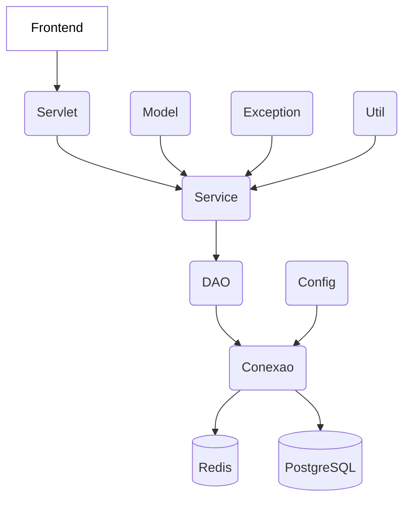

<div align="center">

# Elos

**Conectando pessoas, empresas e oportunidades no setor fotovoltaico.**

</div>

---

## Sobre o Elos

O **Elos** é uma plataforma digital voltada ao setor de energia solar fotovoltaica. Sua proposta é aproximar os diferentes participantes desse mercado — como consumidores, empresas, fornecedores e profissionais especializados — em um único ambiente, facilitando a descoberta de soluções, a conexão entre as partes e a realização de negócios.

A plataforma atua como um **intermediador digital**: organiza o contato entre quem procura soluções fotovoltaicas e quem oferece produtos ou serviços, sem assumir diretamente a execução das instalações ou o fornecimento dos equipamentos.

Este repositório contém o **CRUD do Elos**, responsável pela camada de servidor da aplicação, pelo processamento das requisições, pelas operações de persistência e pelas integrações com serviços externos.

## Objetivos do backend

- Centralizar o processamento das requisições recebidas pela aplicação.
- Implementar operações de cadastro, consulta, atualização e exclusão de dados.
- Persistir informações em um banco de dados PostgreSQL.
- Disponibilizar integração com Redis por meio de um pool de conexões.
- Apoiar funcionalidades de segurança, manipulação de JSON e envio de e-mails.
- Manter configurações e credenciais fora do código-fonte, por meio de variáveis de ambiente.

## Tecnologias e ferramentas

| Tecnologia | Utilização |
|---|---|
| **Java 25** | Linguagem e plataforma de desenvolvimento. |
| **Jakarta Servlet 6** | Processamento das requisições HTTP no servidor. |
| **JSP e JSTL** | Recursos de apresentação e renderização de páginas. |
| **Apache Tomcat 11** | Container responsável pela execução da aplicação web. |
| **Apache Maven** | Gerenciamento de dependências e processo de build. |
| **PostgreSQL** | Banco de dados relacional. |
| **HikariCP** | Pool de conexões com o banco de dados. |
| **Redis + Jedis** | Integração com Redis por meio de cliente Java e pool de conexões. |
| **Gson** | Serialização e desserialização de dados JSON. |
| **jBCrypt** | Biblioteca para hash de senhas. |
| **dotenv-java** | Leitura de configurações a partir de arquivo `.env`. |
| **Brevo** | Provedor utilizado na configuração de envio de e-mails. |
| **HTML** | Linguagem utilizada para criar a estrutura das páginas em JSP. |
| **CSS** | Linguagem utilizada para estilizar as páginas em JSP. |
| **JavaScript** | Envio dos dados via fetch ao servlet, além de tornar as páginas mais interativas. |

## Organização da aplicação

O backend utiliza uma organização baseada em componentes, com responsabilidades separadas entre a camada web, o acesso a dados e a infraestrutura.



### Persistência e padrão DAO

A camada de acesso a dados utiliza o padrão **DAO (Data Access Object)** para concentrar as operações realizadas no banco.

A interface `GenericDAO` define um contrato comum para as operações fundamentais de persistência:

- `insert`: inserção de registros;
- `readAll`: consulta de registros;
- `update`: atualização de registros;
- `delete`: exclusão de registros.

A classe `CriarInstrucaoDinamica` auxilia na montagem de instruções SQL. Ela permite compor consultas com condições `WHERE`, ordenação `ORDER BY` e relacionamentos `JOIN`, além de aplicar os valores aos `PreparedStatement` correspondentes.

Essa abordagem reduz a duplicação de código entre os DAOs e permite construir consultas de forma dinâmica. Em vez de implementar um método específico para cada combinação possível de filtros, ordenações e relacionamentos, a aplicação monta as instruções SQL conforme os parâmetros recebidos.

Dessa maneira, a implementação evita a explosão combinatória de métodos, mantendo as operações de persistência mais flexíveis, reutilizáveis e organizadas.

### Conexões e serviços

- **PostgreSQL:** utilizado para persistência relacional, com gerenciamento de conexões por HikariCP.
- **Redis:** acessado por meio do cliente Jedis. A classe `ConexaoRedis` configura um `JedisPool` para reutilização de conexões.
- **Configuração:** a classe `config.Env` centraliza a leitura das variáveis de ambiente.
- **E-mail:** as configurações incluem credenciais para integração com o provedor Brevo.
- **Segurança:** o projeto inclui bibliotecas e configurações de suporte a hash de senhas e chaves de criptografia.

## Requisitos

Antes de executar o projeto, certifique-se de ter instalado:

- **JDK 25**;
- **Maven 4**;
- **Tomcat 11**;
- **PostgreSQL**;
- **Redis**.

## Configuração do ambiente

A aplicação obtém suas configurações por meio da classe `config.Env`, utilizando a biblioteca `dotenv-java`.

Crie um arquivo chamado **`.env` na raiz do projeto** (diretório de execução) com as variáveis abaixo:

```env
POSTGRESQL_URL=jdbc:postgresql://localhost:5432/elos
POSTGRESQL_USUARIO=postgres
POSTGRESQL_SENHA=sua_senha_do_postgres

REDIS_HOST=localhost
REDIS_PORT=6379
REDIS_SENHA=

AES_KEY=COLOQUE_SUA_CHAVE_AES_EM_BASE64
HMAC_KEY=COLOQUE_SUA_CHAVE_HMAC_EM_BASE64

BREVO_API_KEY=SUA_CHAVE_DE_API_BREVO
EMAIL_USUARIO=seu_email_de_envio
```

### Descrição das variáveis

| Variável | Descrição |
|---|---|
| `POSTGRESQL_URL` | URL JDBC de conexão com o PostgreSQL. |
| `POSTGRESQL_USUARIO` | Usuário utilizado na conexão com o banco. |
| `POSTGRESQL_SENHA` | Senha do usuário do PostgreSQL. |
| `REDIS_HOST` | Endereço do servidor Redis. |
| `REDIS_PORT` | Porta do servidor Redis. |
| `REDIS_SENHA` | Senha do Redis. Pode ficar vazia quando a instância não exigir autenticação, mas a variável deve existir. |
| `AES_KEY` | Chave AES em Base64. |
| `HMAC_KEY` | Chave HMAC em Base64. |
| `BREVO_API_KEY` | Chave de API da conta Brevo. |
| `EMAIL_USUARIO` | Endereço de e-mail utilizado pela integração de envio. |

As chaves `AES_KEY` e `HMAC_KEY` são decodificadas a partir de Base64 pela aplicação. Um exemplo de geração de uma chave aleatória de 32 bytes é:

```bash
openssl rand -base64 32
```

Gere chaves distintas para AES e HMAC e utilize os tamanhos compatíveis com os algoritmos empregados no código. **Nunca compartilhe essas chaves nem envie o arquivo `.env` para o GitHub.**

> **Atenção:** o código exige que as variáveis utilizadas por `config.Env` estejam definidas. Mesmo quando o Redis não possui senha, mantenha `REDIS_SENHA=` no arquivo. Em ambientes de produção, configure os mesmos valores diretamente no gerenciador de variáveis de ambiente da plataforma de hospedagem.

> **Proteção de credenciais:** o `.gitignore` atual contempla `src/main/resources/.env`, mas o `dotenv-java` procura, por padrão, o arquivo `.env` no diretório de execução. Antes de criar o `.env` na raiz, adicione `/.env` ao `.gitignore` para impedir que credenciais locais sejam versionadas.

## Executando localmente

### 1. Clone o repositório

```bash
git clone https://github.com/Solierrr/elos-backend.git
cd elos-backend
```

### 2. Prepare os serviços

Inicie o PostgreSQL e o Redis e certifique-se de que ambos estejam acessíveis a partir do ambiente em que o backend será executado.

Crie o banco indicado em `POSTGRESQL_URL` e disponibilize a estrutura de tabelas esperada pela aplicação.

### 3. Configure as variáveis

Crie o `.env` na raiz do projeto e preencha todas as variáveis apresentadas na seção [Configuração do ambiente](#configuração-do-ambiente).

### 4. Gere o pacote WAR

```
mvn clean package
```
Ao final do processo, o Maven gera o arquivo `.war` no diretório `target/`.

### 5. Execute no Tomcat

Utilize um servidor **Apache Tomcat 11** com **Java 25** e publique o WAR gerado no diretório `webapps` do Tomcat.

Para disponibilizar a aplicação na raiz do servidor, o arquivo pode ser publicado com o nome `Elos.war`. Com o Tomcat iniciado, acesse:

```text
http://localhost:8080/Elos
```

## Licença

Este projeto está disponibilizado sob a licença **MIT**. Consulte o arquivo [LICENSE](./LICENSE) para conhecer os termos de utilização.

---

<div align="center">

**Elos — Conectando o futuro da energia solar.**

</div>
